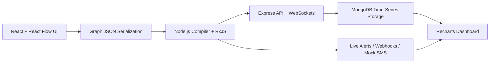

# NexusFlow

NexusFlow is a visual IoT telemetry and rule engine for factory-floor monitoring and alert workflows. Teams can draw rules as nodes and edges, compile them into reactive streams, and observe live telemetry from sensors through dashboards and webhook/SMS alert actions.

## Architecture

## Stack

- Client: React, Vite, React Flow, Recharts
- Server: Node.js, Express, WebSockets, RxJS, MongoDB
- Simulator: Node.js telemetry generator with anomaly simulation
- Shared: Graph schema and cross-team contract files

## Team

| Member | Role | Branch |
|---|---|---|
| Abhay | Team Lead, stream compiler, architecture, integration | `abhay-team-lead` |
| Tanvi | React app, canvas, custom nodes, serialization | `tanvi-frontend` |
| Abhishek | Telemetry simulator, dashboards, alerts UI, testing | `abhishek-audio` |
| Kajal | MongoDB time-series, ingestion API, WebSockets, webhooks | `kajal-backend` |

## Setup

1. Install dependencies:
   - `cd client && npm install`
   - `cd ../server && npm install`
   - `cd ../simulator && npm install`
2. Copy `.env.example` to `.env` in the repo root and update values.
3. Start the server:
   - `cd server && npm start`
4. Start the client:
   - `cd client && npm run dev`
5. Start the simulator:
   - `cd simulator && npm start`

## Performance targets

- 5,000 writes/sec ingestion audit
- valid graph JSON serialization and round-trip
- live rule execution against streaming telemetry
- webhook/mock-SMS alert delivery
- glowing wire feedback on active rule paths

## Week plan

- Week 1: time-series design, ingestion endpoints, canvas scaffolding
- Week 2: stream compiler, node library, graph serialization
- Week 3: live execution, Recharts dashboards, WebSocket integration
- Week 4: alerting, polish, demo and performance validation

## Project status

This repository is bootstrapped with a minimal runnable structure for the client, server, and simulator so all contributors can begin working immediately.
